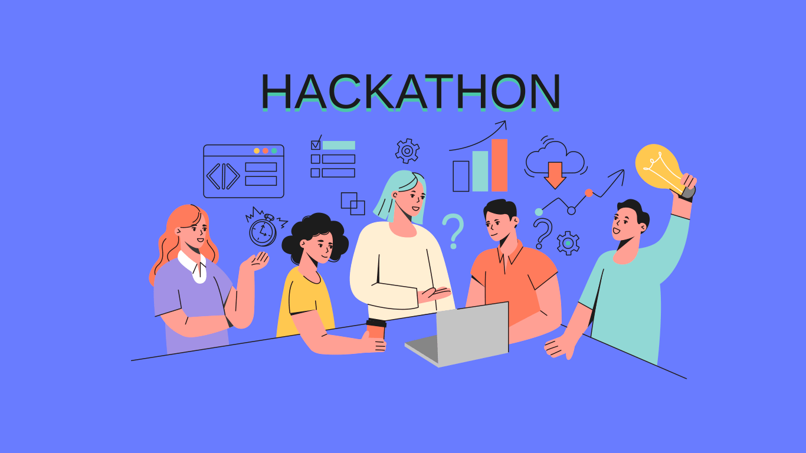
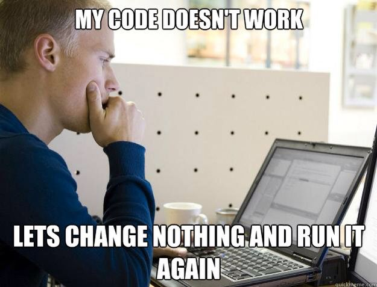

# Hackathon e Projeto Final

Bem-vindos ao último dia do nosso minicurso! Hoje é o dia de colocar em prática tudo o que foi aprendido até aqui. O formato de hoje será um Hackathon, uma maratona de programação focada em construir um projeto completo do zero.

 

---

## Planejamento Inicial
Todo bom software começa com um bom planejamento. Antes de escrever a primeira linha de código, precisamos saber exatamente o que vamos construir.

 

### Apresentação do Escopo
A primeira etapa é decidir o que sua API vai fazer. Vocês têm total liberdade para escolher um tema que achem divertido ou útil. No entanto, se estiverem sem ideias, temos três opções clássicas e muito eficientes para treinar:

*   **Inventário de RPG:** Uma API para gerenciar os itens de um personagem (nome do item, quantidade, tipo de dano, raridade).
*   **Gerenciador de Tarefas (To-Do List):** Um sistema para anotar coisas a fazer, marcá-las como concluídas, definir prazos e prioridades.
*   **Cadastro de Alunos:** Um sistema clássico de gestão escolar, registrando nome, matrícula, curso e notas dos alunos.

### Modelagem Coletiva
Com o tema escolhido, é hora de desenhar a estrutura do projeto. Peguem um papel ou abram um bloco de notas e definam:
*   **As Rotas da API:** Quais caminhos o usuário vai acessar? (Ex: GET /itens para listar tudo, POST /itens para criar, DELETE /itens/{id} para apagar).
*   **Os Atributos do Pydantic:** Como será o formato dos dados recebidos e enviados? Se for um item de RPG, o modelo Pydantic precisa ter um campo nome (string), quantidade (inteiro) e magico (booleano). O Pydantic será nosso segurança, garantindo que ninguém cadastre um item com quantidade em texto no lugar de números.

---

## Desenvolvimento e Mão na Massa

Agora vocês podem colocar a mão na massa!

 

Durante este período, cada grupo programará no seu próprio ritmo. Para que o projeto seja considerado concluído e validado, ele precisa cumprir os seguintes requisitos obrigatórios:

1.  **CRUD Completo:** A sua API precisa fazer as quatro operações básicas de banco de dados:
    *   Create (Criar - POST)
    *   Read (Ler - GET)
    *   Update (Atualizar - PUT ou PATCH)
    *   Delete (Apagar - DELETE)
2.  **Leitura e Escrita em JSON:** Os dados não podem sumir quando o servidor for reiniciado. Vocês deverão implementar a persistência salvando e lendo as informações de um arquivo .json local.
3.  **Separação em Módulos:** Um código profissional é um código organizado. Vocês não farão tudo em um arquivo só. 
    *   main.py: Ficará responsável apenas pelas rotas (os endpoints) e pela configuração do FastAPI.
    *   db.py (ou similar): Ficará responsável apenas pela lógica de abrir o arquivo JSON, salvar os dados e buscar informações.
4.  **Tratamento de Erros:** A API não pode "quebrar" ou exibir telas assustadoras de erro interno (Erro 500) para o usuário. Vocês devem usar o HTTPException para retornar:
    *   Erro 404 (Not Found): Quando o usuário tentar buscar, atualizar ou deletar um item que não existe (um ID inválido).
    *   Erro 400 (Bad Request): Quando o usuário mandar uma informação inválida que não faça sentido para a regra de negócio.

Lembrete: Travou? Pesquise na documentação oficial, olhe os códigos dos dias anteriores, pergunte para o professor, pergunte para a IA!

Aviso: A IA  generativa (gemini, claude) pode ser muito útil ao longo do desenvolvimento, mas lembre-se que seu objetivo aqui é aprender! Tente utilizar essas ferramentas para nortear seu desenvolvimento, não para receber a resposta pronta.

---

## Code Review e Testes Integrados
Desenvolver é apenas metade do trabalho de um programador. A outra metade é garantir que o código funciona e interagir com o código de outras pessoas da equipe.

 

### Compartilhando e Clonando o Repositório
*   Subam o código: Façam os commits e enviem o projeto finalizado para o GitHub.
*   Troca de Projetos: Compartilhem o link do repositório com um outro grupo. Cada grupo deverá acessar o repositório de um outro grupo e clonar o projeto para a sua própria máquina usando o comando git clone (ou baixando o repo).

### Testando a API do Colega
Agora vocês atuarão como Engenheiros de Testes (QA - Quality Assurance). 
*   Suba o servidor do colega: Rode a aplicação que você acabou de clonar.
*   Acesse o Swagger: Abra o /docs no navegador. A documentação interativa gerada pelo FastAPI estará lá.
*   Missão - Tentar "Quebrar" a API: Seu objetivo é encontrar falhas. 
    *   O que acontece se você enviar um texto onde deveria ser a idade?
    *   O que acontece se você tentar apagar um item passando um ID que não existe?
    *   A API retorna a mensagem de erro correta ou o servidor trava completamente?

Feedback construtivo: Anotem os bugs que encontrarem e repassem para os colegas de forma amigável para que eles possam corrigir!
